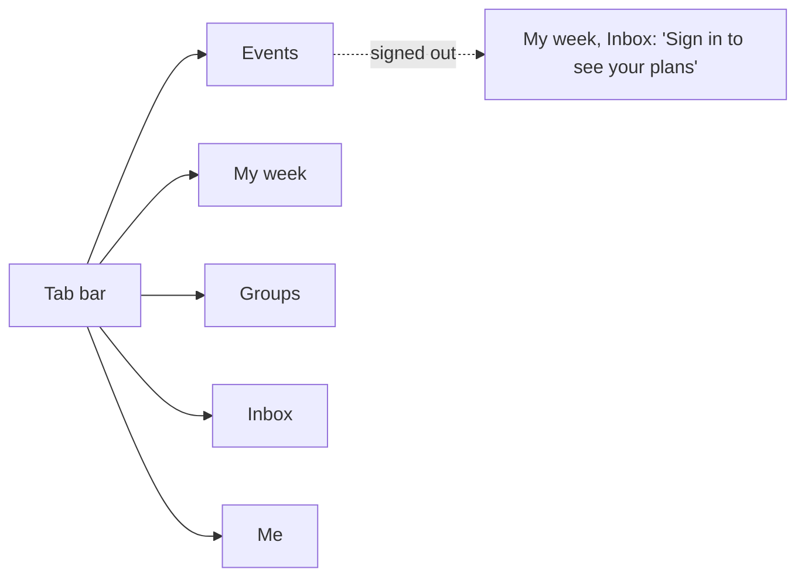
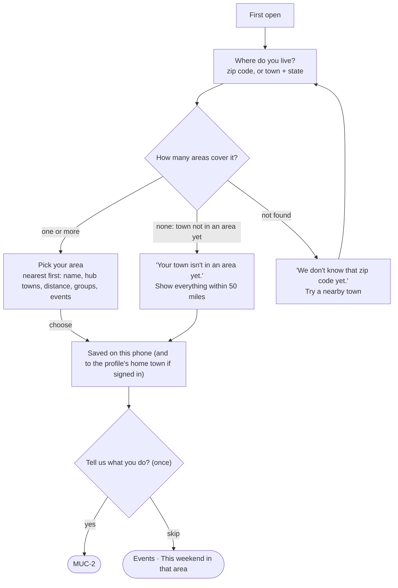
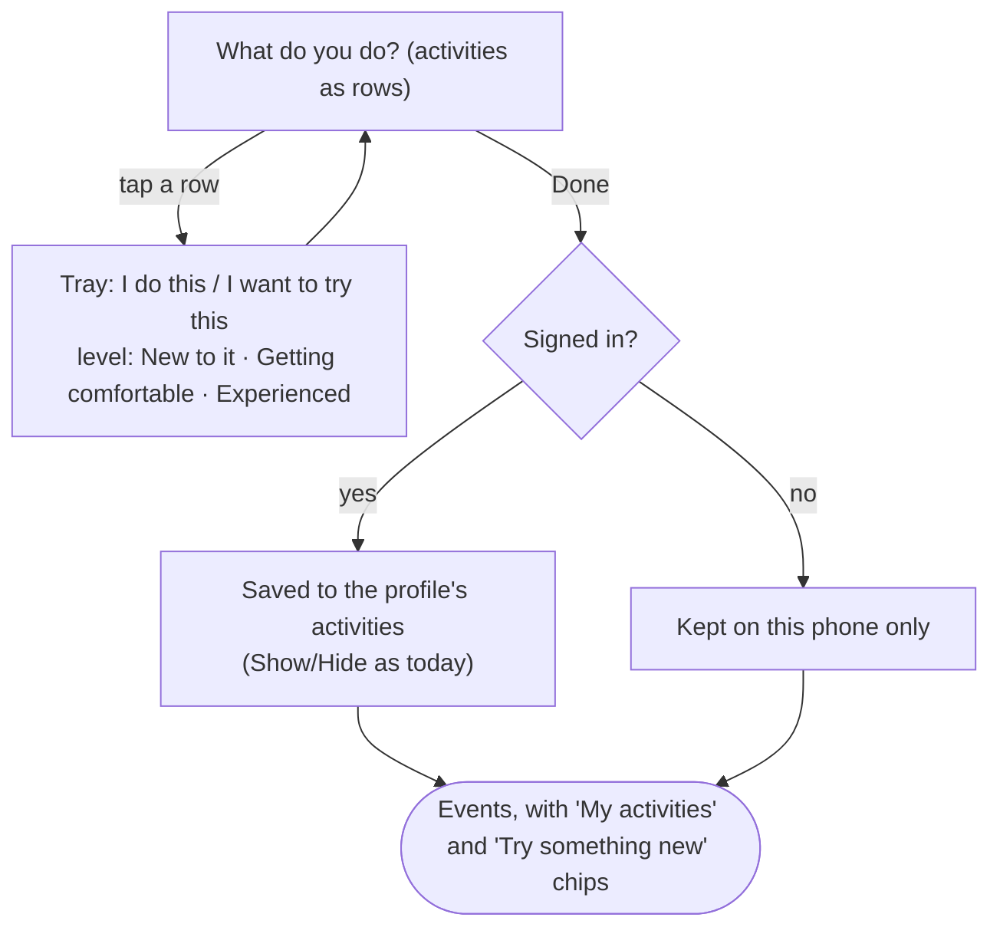
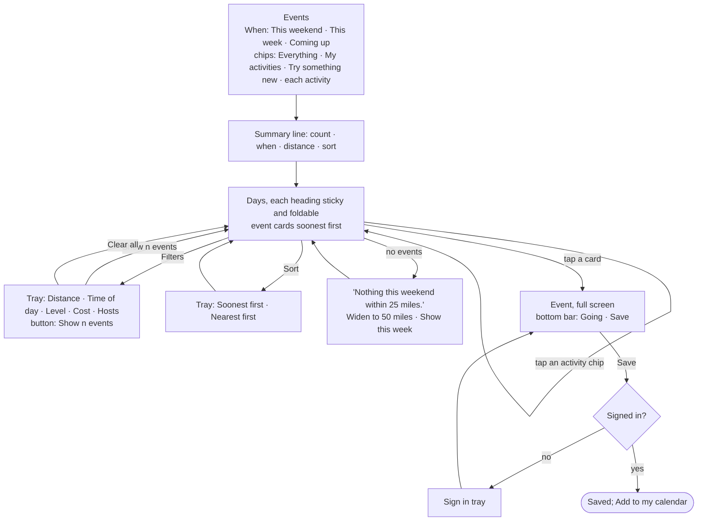
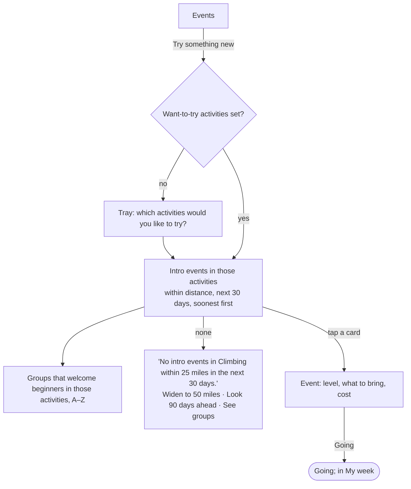
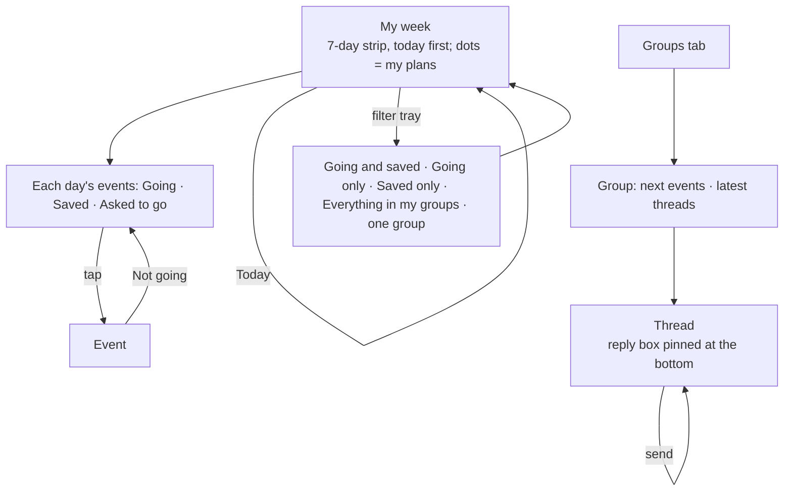
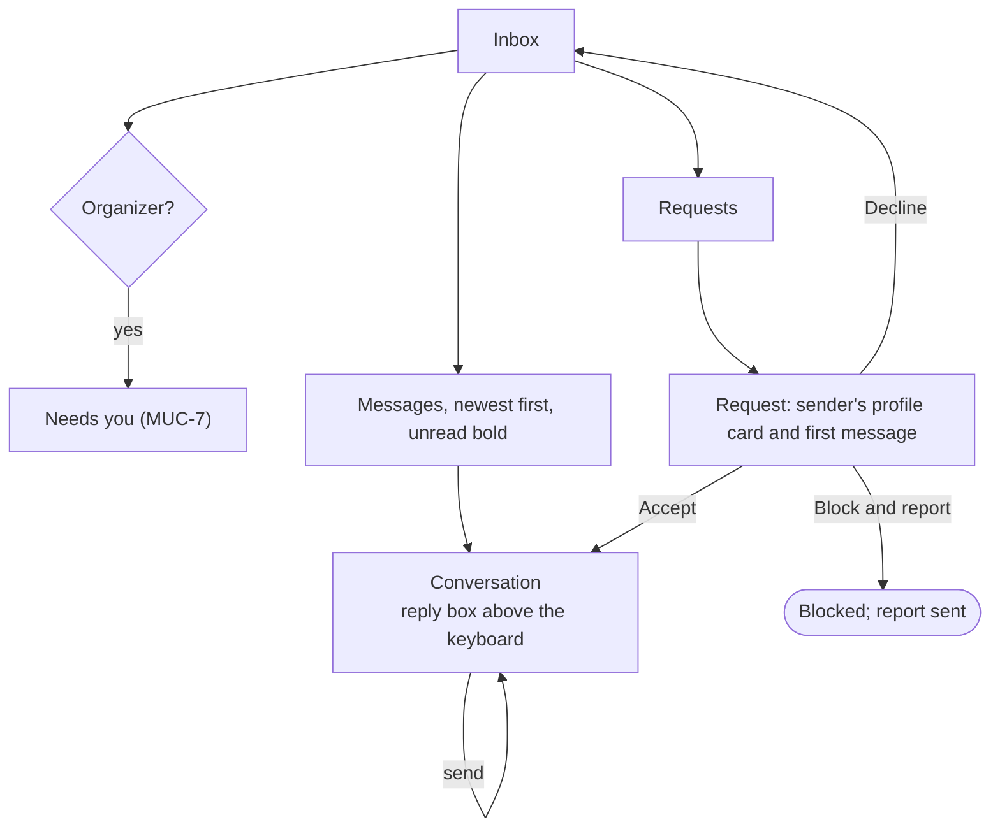
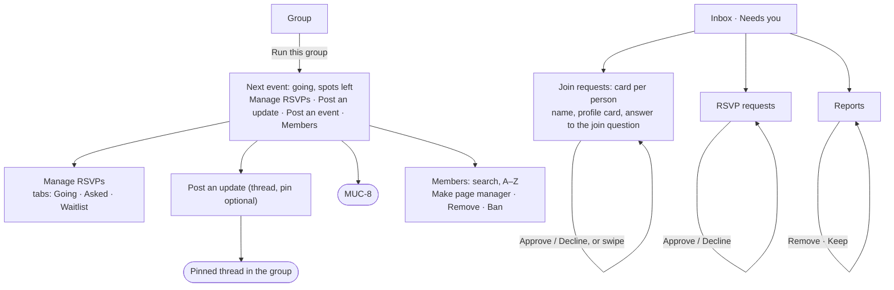
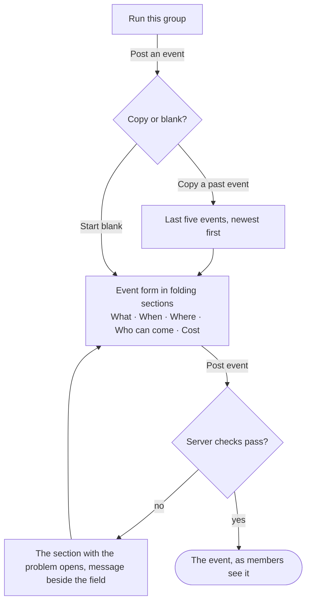

# Mobile user flows

> **Draft, awaiting review** (14 October 2026). One diagram per
> [mobile use case](./use-cases). Rectangles are screens, diamonds are
> decisions, rounded boxes are where the flow ends; a tray is marked
> *tray* (it slides up over the screen it belongs to, see the
> [design system](./design-system#trays)).

The tab bar is always there except on full-screen pages (an event, a
conversation, a form), which have a back arrow instead:

## MUC-1 — Set up around where I live

## MUC-2 — What I do and what I want to try

## MUC-3 — What's on this weekend

## MUC-4 — Try something new

## MUC-5 — My week

## MUC-6 — Answer my messages

## MUC-7 — Run my group from my phone

## MUC-8 — Post an event from my phone

